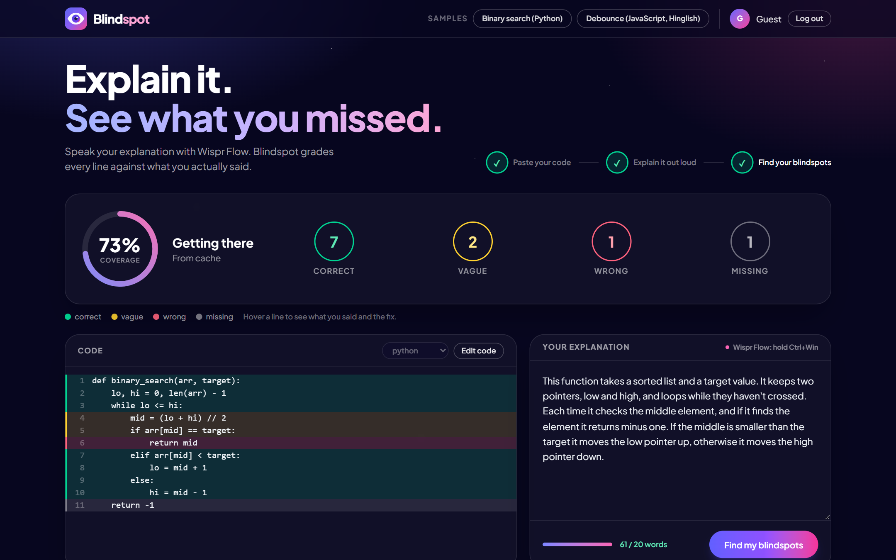
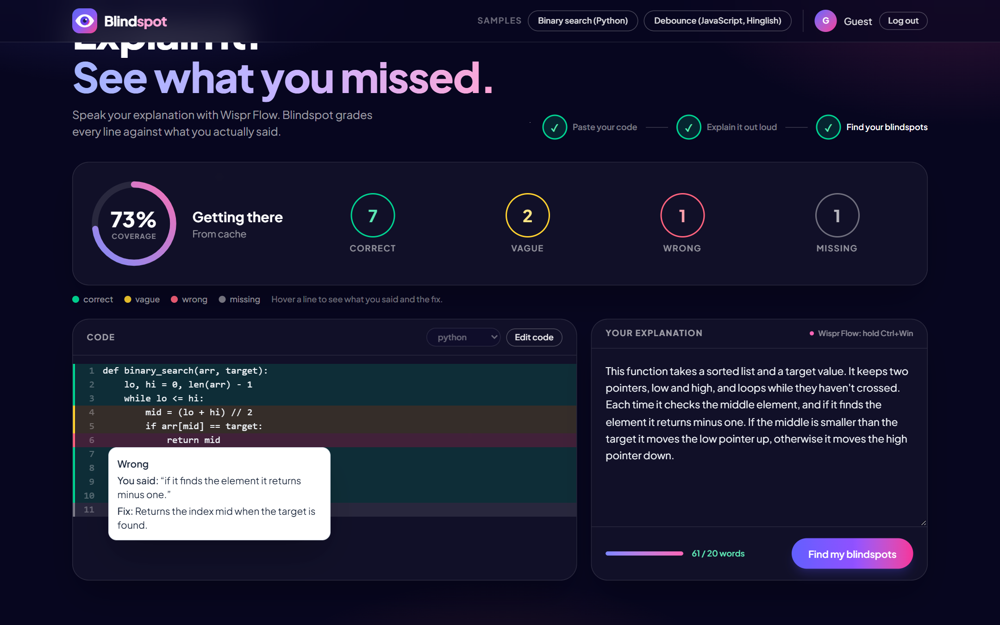
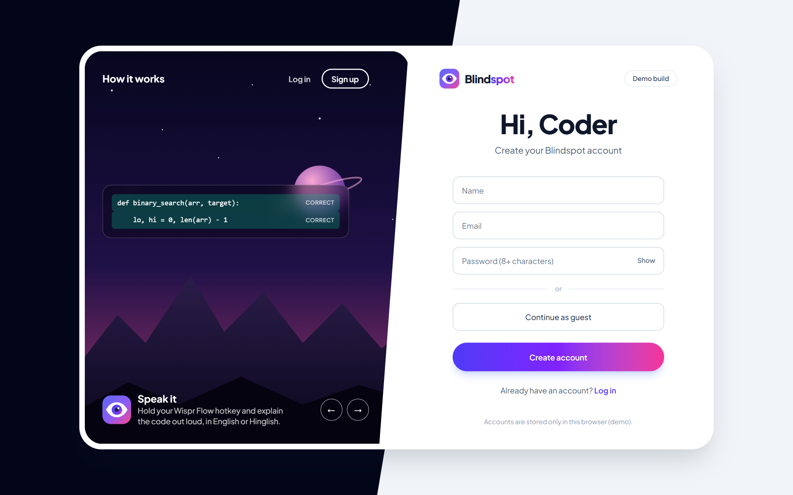
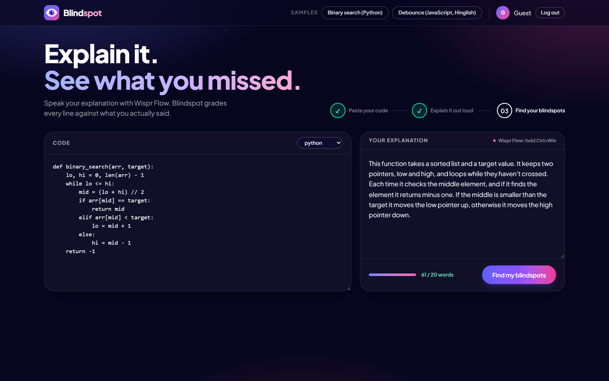
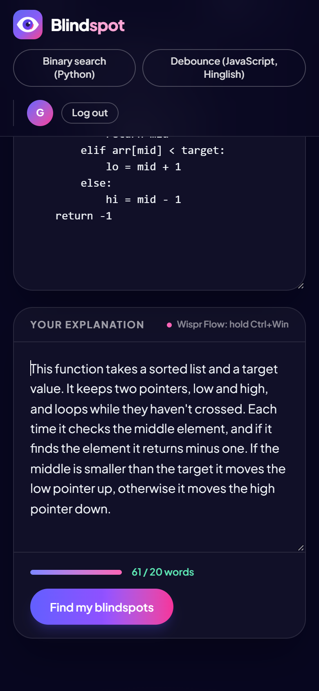
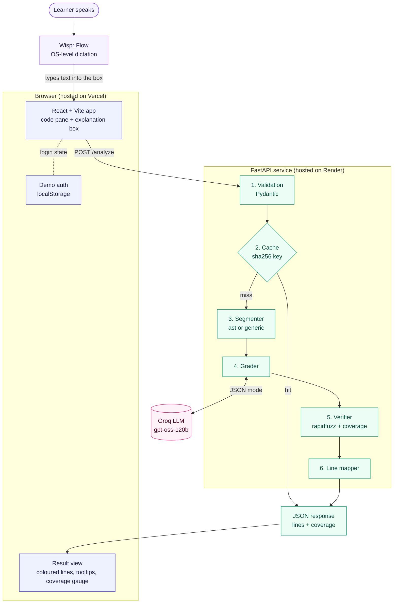
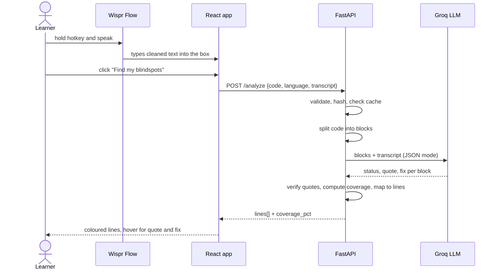

<div align="center">


# Blindspot

### Explain your code out loud. See, line by line, what you didn't really understand.

[](https://www.python.org)
[](https://fastapi.tiangolo.com)
[](https://react.dev)
[](https://www.typescriptlang.org)
[](https://tailwindcss.com)
[](https://groq.com)
[](https://wisprflow.ai)

[**Problem**](#the-problem) · [**Solution**](#the-solution) · [**Impact**](#impact) · [**Why it's different**](#why-blindspot-is-different) · [**Architecture**](#architecture) · [**Tech stack**](#tech-stack) · [**Market**](#market-opportunity) · [**Setup**](#setup-and-run-it-locally) · [**Deploy**](#deploy)

<br />



</div>

---

## The problem

Explaining code out loud is the fastest honest test of whether you understand it. It's the idea behind rubber-duck debugging and the Feynman technique, and it's exactly what a technical interviewer asks for: *"walk me through your code."*

But a rubber duck never answers. When you explain, you can't tell:

- which lines you **skipped** without noticing,
- which lines you described **vaguely** ("then it does something with the pointer"),
- which lines you described **wrongly** ("it returns -1 when it finds the element").

### A concrete example

> *Illustrative scenario, not a real person.*
>
> **Aarav** is a final-year B.Tech student preparing for campus placements. He gets stuck on *Two Sum*, asks an AI assistant for the solution, reads it, and thinks *"makes sense."* He moves on to the next problem.
>
> In the interview he is asked: *"Why do you store the index in the dictionary and not the number?"* He answers *"it, uh, checks the numbers"* and freezes. He wasn't being lazy. **Nothing ever tested his explanation**, so he never found out he didn't have one.

Typing a full explanation is too slow, so people skip it. Asking a chatbot "did I explain this right?" returns a paragraph of general feedback that isn't tied to specific lines, and chatbots lean towards praise.

### Is this problem real? What the data says

| What we claim | Evidence | Source |
|---|---|---|
| **People overestimate how well they understand things, until they try to explain them.** | In the classic study, participants rated their understanding of everyday devices, then wrote step-by-step explanations and re-rated. Ratings **dropped** after explaining. The effect was specific to explanatory knowledge: smaller for facts and narratives, absent for procedures. (Later work has refined the account.) | Rozenblit & Keil, *Cognitive Science* (2002), summarised on [Wikipedia](https://en.wikipedia.org/wiki/Illusion_of_explanatory_depth) |
| **Explaining to yourself makes you learn more.** | Eighth-graders prompted to self-explain each line of a text (n=14) beat a read-twice control group (n=10) on recall and transfer. Small sample, but a foundational result. | Chi et al., *Cognitive Science* (1994), [PDF](https://pcl.sitehost.iu.edu/rgoldsto/courses/cogscilearning/chiselfexplanation.pdf) |
| **Developers use AI heavily, but don't trust it.** | **80%** use AI tools; only **29%** trust their accuracy (down from 40%). The top frustration, at **45%**, is *"AI solutions that are almost right, but not quite."* **75%** would still ask a person. n > 49,000. | [Stack Overflow Developer Survey 2025](https://stackoverflow.blog/2025/07/29/developers-remain-willing-but-reluctant-to-use-ai-the-2025-developer-survey-results-are-here/) |
| **People increasingly learn to code *with* AI.** | **44%** learned new coding techniques with AI-enabled tools, up from 37% a year earlier. | Same survey |
| **Novices hand the thinking to the AI.** | In a monitored study of 37 programming students, 23 used ChatGPT and *most of those eventually asked it to simply generate a full solution*, often looping through wrong code and "fix it" requests. | Rahe & Maalej, FSE 2025, [arXiv:2501.10091](https://arxiv.org/abs/2501.10091) |
| **AI-written code is now the norm in Indian engineering colleges.** | IIT Delhi's own committee report (427 students, 88 faculty): nearly **81%** of students use AI tools regularly (several times a week) and **62%** use them for coding. | IIT Delhi, [*On the use of Generative AI at IIT Delhi*](https://academics.iitd.ac.in/wp-content/uploads/2025/09/IITD-AI-Guidelines.pdf) (Sept 2025) |
| **Students mostly use chatbots to *understand* and debug code, which is where false confidence creeps in.** | Among US engineering students (n=601 in 2023, n=862 in 2024), the preferred coding uses were understanding what code does (**44%**) and debugging (**48.4%**), ahead of drafting code (26.5%). | Ovi, Fierro & Smith, [arXiv:2503.04696](https://arxiv.org/abs/2503.04696) |
| **Universities are adding oral "code vivas" in response.** | UWE Bristol made a mandatory code viva worth **30%** of a first-year JavaScript module (about 20-30 students) and reports that in a few cases students struggled to explain work they had submitted. Its suggested next step is *low-stakes mini vivas so students can practise*, which is what Blindspot offers on demand. | Simon Emberton, [UWE Digital Learning](https://digitallearning.uwe.ac.uk/ai-proofing-assessment-through-code-vivas/) (16 Oct 2026) |
| **The audience is huge, especially in India.** | AICTE sanctioned a record **15.98 lakh (about 1.6 million) B.Tech seats** for 2025-26, with computer science driving the rise. That is roughly 1.6 million students entering engineering every year. | [Careers360 on AICTE data](https://news.careers360.com/btech-courses-aicte-engineering-enrolment-rise-ai-computer-science-cs-job-decline-civil-mechanical-data-5-yr-high-placement-salary) |

<sub>**Read these honestly.** The 2002 and 1994 studies are old and small; the AI-and-students evidence is early; the UWE case is one module of 20-30 students and the Mines study surveyed US students, not Indian ones; the India figure counts *all* engineering branches, not just CS. Together they support a clear direction (explaining reveals gaps; AI makes it easier to skip explaining), not a proof that Blindspot works. Our own accuracy is covered under [Quality and honesty](#quality-and-honesty).</sub>

**What's missing:** a fast, *spoken* way to explain code that gives honest, **line-level** feedback you can check, showing exactly where your understanding has gaps.

---

## The solution

**Blindspot** is a web app that grades your spoken explanation of a piece of code, line by line.

<table>
<tr>
<td width="33%" valign="top">

**1. Paste or pick code**

Paste a snippet (up to 150 lines) or load a sample. Python gets exact parsing; JavaScript, TypeScript, Java and C++ are supported too.

</td>
<td width="33%" valign="top">

**2. Explain it out loud**

Click the explanation box, hold your [Wispr Flow](https://wisprflow.ai) hotkey and talk, in English or Hinglish. Wispr Flow types your words in. No audio code in our app.

</td>
<td width="33%" valign="top">

**3. Find your blindspots**

Every line is coloured. Hover to see **the exact words you said** and a **one-line fix**.

</td>
</tr>
</table>

| Colour | Status | Meaning |
|---|---|---|
| 🟩 Green | `correct` | You explained this block accurately. |
| 🟨 Yellow | `vague` | You mentioned it without saying what it actually does. |
| 🟥 Red | `wrong` | What you said contradicts what the code does. |
| ⬜ Grey | `missing` | You didn't cover this block at all. |
| none | `neutral` | Blank lines, comments, imports, bare braces. Not graded. |

<div align="center">

<br /><sub>Hover a line: the exact words you said, and the fix. Here the learner said <em>"it returns minus one"</em> about <code>return mid</code>.</sub>
</div>

### Why you can trust the output

Language models flatter and invent. Blindspot is built so they can't:

1. **Quotes are verified.** Every "you said X" is fuzzy-matched (rapidfuzz, threshold 85) against your transcript. A quote the model made up **downgrades that block to *missing***. We downgrade rather than upgrade, because a false "you got it" is worse than a false "you missed it".
2. **The score is plain Python.** Coverage = (correct + 0.5 × vague) ÷ graded blocks, calculated outside the model, so it's predictable and testable.
3. **The model doesn't decide what the blocks are.** Code is split by Python's `ast` (or a brace/indent splitter for other languages) *before* grading. The model only grades.
4. **Skipped or invented blocks are handled.** Blocks the model forgets are filled in as *missing*; block IDs it makes up are dropped.

### The experience

<div align="center">


<br />

<br /><sub>Login (demo accounts), the three-step workspace, and the mobile layout.</sub>
</div>

---

## Impact

**For learners.** Turns the vague feeling "I get it" into a checkable result. You find the one line you can't explain *before* the interviewer does, and you can re-record and watch the score move.

**For educators and bootcamps.** Oral-exam-style feedback normally needs a person's time. Blindspot gives every student immediate, line-level feedback on their explanation, and gives instructors a consistent rubric.

**For placement cells and interview prep.** Practising "walk me through your code" becomes something you can do alone at midnight, in English or Hinglish, with evidence rather than opinion.

**In the age of AI-written code.** 80% of developers use AI tools but most don't trust the output (see the [data](#is-this-problem-real-what-the-data-says)). The scarce skill is *understanding* code you didn't write. Blindspot is a check on exactly that, without telling you the answer first.

### Business impact

| Stakeholder | Value | How it could pay |
|---|---|---|
| **Individual learners and job-seekers** | Faster, cheaper practice than scheduling mock interviews; measurable progress | Freemium subscription |
| **Colleges, bootcamps, training providers** | Scalable explanation feedback; better-prepared graduates and placement outcomes | Per-seat or per-cohort licence |
| **Interview-prep and assessment platforms** | A new, hard-to-fake signal: can the candidate explain their own solution? | API or white-label |
| **Engineering teams** | Faster onboarding by testing understanding of the codebase | Team plan (later) |

**What we would measure** (none of these has been measured yet): activation (first graded explanation), repeat practice rate, *coverage gain between consecutive attempts on the same snippet* (the real learning signal), agreement with human labels, and false-praise rate.

---

## Unique value proposition

> **Other tools explain code *to* you. Blindspot checks your explanation *of* it, line by line, with proof of what you said.**

- **It grades the human, not the code.** The thing under test is your understanding.
- **Evidence you can check.** Every claim quotes your own words, and made-up quotes are rejected.
- **Voice-first, with zero audio plumbing.** Wispr Flow turns speech into text anywhere, so we inherit its accuracy and Hinglish support, and have no speech code to break.
- **Honest by construction.** Deterministic block splitting, a Python-computed score, and downgrade-only verification.
- **Built for how people in India actually speak.** Hinglish explanations are graded like English.

## Why Blindspot is different

| | **Blindspot** | Chat assistants (e.g. ChatGPT, Copilot Chat) | Practice platforms (e.g. LeetCode) | Human mock interviews or mentors |
|---|---|---|---|---|
| **Who does the explaining?** | **You** | The AI, to you | You write code; tests judge it | You, to a person |
| **Feedback on *your* explanation** | **Yes, per block** | Only if you prompt for it; free-form paragraph | Not the focus | Yes, but subjective |
| **Tied to specific lines** | **Yes, coloured per line** | Usually not | n/a | Sometimes |
| **Shows your exact words** | **Yes, verified against the transcript** | No | n/a | Depends on the person |
| **Speed** | Seconds | Seconds | Seconds | Needs scheduling |
| **Cost** | Free tier friendly | Free to paid | Premium is roughly $159/year per [reviews](https://www.lodely.com/blog/leetcode-premium-cost) (sources vary) | Varies, usually the highest |

**Closest research prior art: ESSE** (Lekshmi-Narayanan, Brusilovsky et al., [arXiv:2608.25180](https://arxiv.org/abs/2608.25180), 2026). It is a self-explanation tutor for introductory Java in which students *type* an explanation of **one line at a time** and get LLM feedback. Its LLM judged explanation correctness with **F1 = .91 against an expert** (precision .95, recall .87 on 358 rated attempts), which is good evidence that LLM grading of explanations is feasible. Blindspot differs in the interaction: **one continuous spoken explanation of the whole program**, aligned back onto the code as a coverage heatmap, with quotes verified against the transcript.

<sub>This is a comparison by **category**. We have not benchmarked individual products, and these tools improve quickly, so treat the table as positioning, not a test result. Chat assistants *can* be prompted to critique an explanation; the difference is structure and verification.</sub>

## Built for The Wispr Challenge (Builders track)

Blindspot was built for **No Hands: The Wispr Challenge** (WeMakeDevs × Wispr Flow), Builders track: a working product that solves a problem in your own work. The problem here is a student's own: *I ship code with an AI assistant, then freeze when asked to explain line 23.*

- **Voice is the product, not a convenience.** The skill a viva or interview tests is *spoken* explanation, so typing it would practise the wrong thing. The explanation box prompts you to hold your Wispr Flow key and talk.
- **Wispr Flow is the input device, by design.** It types cleaned text into whichever field has focus, so Blindspot has no audio code to break and works anywhere Flow does.
- **Hinglish is a first-class case.** Many students think through code in Hinglish; Wispr Flow dictates it and Blindspot grades it like English (see the Hinglish sample).
- **One feature only.** No question bank, chatbot, quizzes or dashboard. You explain; it audits.

---

## Architecture



### One request, end to end



### What each part does

| Part | Responsibility | Why it's built this way |
|---|---|---|
| **Wispr Flow** (external) | System-wide dictation. Removes filler words, handles mixed Hindi-English, types into whichever box has focus. | We never touch audio. To the app, dictation looks like typing, so there is nothing to integrate or break. |
| **React app** (`frontend/`) | `CodePane` and `CodeLine` render graded lines and tooltips; `ExplanationPanel` has the box, word counter and hotkey hint; `CoverageBadge` draws the gauge and per-status rings. | State stays in plain `useState`. Editing code clears old results so colours never sit on new code. |
| **Demo auth** (`auth.tsx`) | Login/signup/guest, with salted SHA-256 hashes in `localStorage`. | Good enough for a demo, and isolated in one file so a real provider can replace it. **Not secure.** |
| **Validation** (`models.py`) | Pydantic rules: at most 150 lines, at least 20 words. | Cheap guardrails with friendly 422 messages, and they cap LLM cost and latency. |
| **Cache** (`cache.py`) | sha256 of language + code + normalised transcript; in memory plus a JSON file; demo samples ship precomputed. | Same input gives the same answer, and the live demo never depends on API rate limits. |
| **Segmenter** (`segmenter.py`) | Splits code into gradable blocks and marks blank lines, comments, imports and braces as neutral. Python uses `ast`; other languages use a brace/indent splitter; a Python syntax error falls back to the generic one. | Without it, `}` and blank lines would count as "missing" and every score would be unfairly low. |
| **Grader** (`grader.py`) | One Groq chat-completion call per request, temperature 0, JSON output, retries on rate limits. Prompt rules: judge meaning not keywords, treat Hinglish like English, quotes must be verbatim. | One call keeps it fast and cheap. The prompt is explicit about what each status means. |
| **Verifier** (`verifier.py`) | Fuzzy-checks every quote against the transcript, downgrades fakes to *missing*, fills skipped blocks, drops invented ones, computes coverage. | This is the anti-hallucination layer: the model's claims are checked, not trusted. |
| **Line mapper** (`mapper.py`) | Turns block results into one entry per line for the UI. | Keeps the API response simple: `lines[]` plus `coverage_pct`. |
| **Calibration harness** (`calibration/`) | Hand-labelled cases, a one-keypress labelling tool, and a script reporting agreement, Cohen's kappa and a confusion matrix. | Turns "it seems to work" into a number, and makes prompt changes measurable. |

---

## Tech stack

| Layer | Choice | Why |
|---|---|---|
| Voice input | **Wispr Flow** | Dictation in any text box, with Hinglish support. Zero integration code. |
| Frontend | **React 18, Vite 6, TypeScript 5** | Fast dev loop, typed API contract, static deploy. |
| Styling | **Tailwind CSS 4**, Plus Jakarta Sans | Status colours as utilities; fast, consistent design. |
| Backend | **Python 3.11, FastAPI, Uvicorn** | Async, automatic OpenAPI docs, Pydantic built in. |
| Validation | **Pydantic v2** | Request validation and response models. |
| LLM | **Groq** (`openai/gpt-oss-120b`) | Fast, free-tier friendly, JSON output. Swappable: the grader is one file. |
| HTTP client | **httpx** | Simple, with timeouts and explicit retry handling. |
| Fuzzy matching | **rapidfuzz** | `partial_ratio` for verifying quotes against transcripts. |
| Code parsing | Python **`ast`** (stdlib) | Exact statement line ranges. |
| Cache | In-memory dict plus JSON file | No infrastructure needed. |
| Testing | **pytest** + FastAPI `TestClient` | 19 tests; the LLM is mocked. |
| Deploy | **Vercel** (frontend), **Render** (backend) | Free tiers, deploy from a git push. |

---

## Market opportunity

> **Read this as a hypothesis.** The *inputs* (developer counts, graduate counts) are sourced. The *prices* and *conversion* are our assumptions and have not been validated with users. Nothing here is implemented as billing yet.

| | Definition | Size | How we got there |
|---|---|---|---|
| **TAM** | Everyone who writes or learns code and could benefit from checking their own understanding | **about $2.3B / year** | 48.4M developers worldwide × $48/year assumed price |
| **SAM** | One cohort a year of engineering and CS students and graduates in our two launch markets, India and the US | **about $25M / year** (about 1.7M people) | India 1.6M × ₹999 (about $12) + US 112,720 × $48 |
| **SOM** | A realistic share we could win in about 3 years | **about $0.5M / year** (about 34,000 paying users) | 2% of the SAM population × blended price of about $14 |

<details>
<summary><b>Method, sources and caveats</b></summary>

**Inputs (sourced)**
- **48.4 million developers worldwide** as of Q3 2025 ([SlashData](https://www.slashdata.co/research/developer-population)); 47.2M, including 36.5M professionals, at the start of 2025. These are modelled estimates; other firms differ (IDC: 40.2M for 2025; Evans Data: 27M for 2024) because they draw the boundary differently.
- **India: a record 15.98 lakh (about 1.6 million) B.Tech seats sanctioned for 2025-26** ([Careers360 on AICTE data](https://news.careers360.com/btech-courses-aicte-engineering-enrolment-rise-ai-computer-science-cs-job-decline-civil-mechanical-data-5-yr-high-placement-salary)). We use it as a proxy for one cohort a year. Seats are not graduates (not every seat is filled), and it covers **all** engineering branches, so it overstates CS specifically; but it also ignores self-taught learners and bootcamp students.
- **US: 112,720 bachelor's degrees in computer and information sciences in 2022-23** ([National Student Clearinghouse](https://studentclearinghouse.org/nscblog/?p=75844)).

**Assumptions (ours, unvalidated)**
- Price anchors: $48/year (about $4/month) globally and ₹999/year (about $12) in India. For context, LeetCode Premium is roughly $159/year ([review](https://www.lodely.com/blog/leetcode-premium-cost), prices vary by source). We price India lower because we expect Indian learners to be more price-sensitive, which is itself an assumption to test.
- SAM counts one graduating cohort per year as a proxy for people actively preparing for jobs. It ignores students in earlier years, career-switchers and bootcamp learners, so it is **conservative** on purpose.
- SOM assumes 2% of that population pays within 3 years. This is a planning figure, not a forecast.

**Sanity check against published market reports** (vendor reports, definitions vary widely, treat as rough): the *coding interview preparation* market is estimated at about **$2.1B in 2025** ([Marketintelo](https://marketintelo.com/report/coding-interview-preparation-market)) and coding bootcamps at roughly **$3-4B** ([Business Research Company, via GII](https://www.gii.tw/report/tbrc1727775-coding-bootcamp-global-market-report.html); [ResearchAndMarkets via Business Wire](https://www.businesswire.com/news/home/20251218159677/en/Trends-Strategies-Shaping-the-$14-Billion-Coding-Bootcamp-Market-2025-2032-Flexible-Curriculum-Delivery-Diverse-Payment-Structures-Adaptable-Program-Formats---ResearchAndMarkets.com)). Our TAM sits in the same order of magnitude, which is reassuring but not proof.

**Upside not counted:** institutional licences (colleges and bootcamps), interview-platform API deals, and team onboarding.

</details>

### Business model (hypothesis)

| Plan | For | Idea |
|---|---|---|
| **Free** | Individuals | A few graded explanations a day; the demo samples |
| **Pro** | Job-seekers | Unlimited gradings, progress history, spaced re-practice of past blindspots |
| **Institutions** | Colleges, bootcamps | Per-seat licence, instructor dashboard, cohort analytics |
| **API** | Interview and assessment platforms | Grade-the-explanation as a service |

**Go-to-market:** start with Indian engineering colleges and placement cells (large, concentrated, Hinglish-native), then bootcamps, then interview-prep communities.

---

## Quality and honesty

- **19 automated tests** cover the segmenter, verifier, mapper and API (the LLM is mocked). They pass.
- **Calibration harness.** `calibration/calibrate.py` compares Blindspot with hand labels: exact agreement, Cohen's kappa, confusion matrix, and good-vs-weak separation. Target: **80%+ agreement, kappa 0.6+**.
- **Current numbers are not an independent result.** Four early seed cases that the assistant labelled while building the scripts gave 84.4% agreement and kappa 0.56 (`calibration/seed_cases/`). The real 20-case set (10 snippets × good and weak, recorded with Wispr Flow) is set up in [`calibration/README.md`](calibration/README.md) and still to be recorded.
- **Known limitations**
  - The grader is an LLM, so runs can vary: we have seen coverage move by roughly 10 points between runs on the same input. The cache keeps repeated inputs stable.
  - Verification checks that a quote *exists* in your transcript, not that the model's *judgement* of it is right.
  - Non-Python languages use a heuristic block splitter, which is less exact than `ast`.
  - Groq's free tier rate-limits (we hit HTTP 429 during development), so the grader retries and the samples are precomputed.
  - Login is **demo only**: accounts live in the browser, nothing is secure or shared across devices, and the API does not know who is logged in.
  - **Privacy:** the code and your transcript are sent to Groq to be graded. The server keeps a cache of results, including your quoted words, on its disk. Don't paste secrets or proprietary code.
  - Blindspot doesn't run your code. It grades the explanation against the code as written.

---

## Setup and run it locally

Blindspot is two small programs: a **Python backend** (port 8000) that does the grading, and a **React frontend** (port 5173) that you open in the browser. You run both.

### Quick start (about 10 minutes)

```bash
git clone https://github.com/danishjk2156/blindspot.git
cd blindspot
```

Then follow steps 1 to 4 below. When both servers are running, open **http://localhost:5173**.

### 1. Prerequisites

| Tool | Version | Check it | Get it |
|---|---|---|---|
| **Python** | 3.11 or newer | `python --version` | [python.org/downloads](https://www.python.org/downloads/) (on Windows, tick *Add python.exe to PATH*) |
| **Node.js** (includes npm) | 20 or newer | `node --version` | [nodejs.org](https://nodejs.org) |
| **Git** | any | `git --version` | [git-scm.com](https://git-scm.com) |
| **Groq API key** | free | see step 2 | [console.groq.com/keys](https://console.groq.com/keys) |
| **Wispr Flow** | optional, for voice | see [below](#6-set-up-voice-with-wispr-flow) | [wisprflow.ai](https://wisprflow.ai) |

On macOS and Linux, if `python` isn't found, use `python3` everywhere below.

### 2. Get a free Groq API key

The grader is an LLM served by Groq's free tier, so you need a key.

1. Go to [console.groq.com/keys](https://console.groq.com/keys) and sign in.
2. Click **Create API Key**, give it any name, and copy it (it starts with `gsk_`).
3. Keep it private. It goes only in `backend/.env`, which git ignores, and never in the frontend.

### 3. Start the backend

Open a terminal in the project folder, then:

<details open>
<summary><b>Windows (PowerShell)</b></summary>

```powershell
cd backend
python -m venv .venv
.venv\Scripts\python -m pip install -r requirements.txt
copy .env.example .env
notepad .env
```

</details>

<details>
<summary><b>macOS / Linux (or Git Bash)</b></summary>

```bash
cd backend
python3 -m venv .venv
.venv/bin/python -m pip install -r requirements.txt
cp .env.example .env
nano .env
```

</details>

In `.env`, paste your key after the equals sign, with no quotes and no spaces:

```
GROQ_API_KEY=gsk_your_key_here
FRONTEND_ORIGIN=http://localhost:5173
DEBUG=0
```

Now start the server (we call the virtualenv's Python directly, so there is nothing to "activate"):

```powershell
# Windows
.venv\Scripts\python -m uvicorn app.main:app --reload --port 8000
```

```bash
# macOS / Linux
.venv/bin/python -m uvicorn app.main:app --reload --port 8000
```

**Check it works:** open [http://localhost:8000/health](http://localhost:8000/health). You should see `{"ok":true}`. Interactive API docs are at [/docs](http://localhost:8000/docs). Leave this terminal running.

### 4. Start the frontend

Open a **second** terminal:

```bash
cd frontend
npm install
npm run dev
```

Open **[http://localhost:5173](http://localhost:5173)**. The frontend talks to `http://localhost:8000` by default. If your backend is elsewhere, copy `frontend/.env.example` to `frontend/.env` and set `VITE_API_URL`.

> Port 5173 is fixed. If something else is using it, `npm run dev` will fail rather than pick another port, because the backend's CORS setting expects 5173.

### 5. Use the app

1. **Sign in.** Click **Continue as guest**, or create a demo account. Accounts are stored only in your browser and are not secure.
2. **Pick code.** The binary-search sample is preloaded. Use **Samples** in the header for the Hinglish JavaScript sample, or click **Edit code** and paste your own (up to 150 lines).
3. **Explain it.** Click into the explanation box and either dictate with Wispr Flow or just type. You need at least **20 words**; the counter turns green when you have enough.
4. **Click "Find my blindspots".** Every line is coloured. Hover a line to see the exact words you said and the fix. The ring shows your coverage score.
5. **Improve it.** Click **Edit code**, adjust your explanation to cover the red and grey lines, and grade again.

The two built-in samples return instantly because their results are precomputed (the badge says *From cache*). Any other code or wording makes a fresh call to Groq, which takes a few seconds.

### 6. Set up voice with Wispr Flow

Voice is optional (typing works), but it is the point of the product.

1. Install Wispr Flow from [wisprflow.ai](https://wisprflow.ai) and sign in.
2. Find your push-to-talk shortcut in Wispr Flow's settings. It works by **holding** the key while you speak.
3. **Windows:** Wispr's docs say the **Fn key isn't recognised on Windows machines**, so use a combination such as **Ctrl+Win** ([hotkey docs](https://docs.wisprflow.ai/articles/2612050838-supported-unsupported-keyboard-hotkey-shortcuts)). **Mac:** Fn works.
4. Click into Blindspot's explanation box first, so it has focus, then hold the key and explain the code out loud. Wispr Flow types the cleaned-up text into the box. Hinglish works too.

### 7. Run the tests and the production build

```bash
# backend tests (the LLM is mocked, so no key is needed)
cd backend
.venv/Scripts/python -m pytest          # macOS/Linux: .venv/bin/python -m pytest

# frontend type-check and production build
cd ../frontend
npm run build
npm run preview                          # serves the built app locally
```

### Troubleshooting

| Symptom | Likely cause and fix |
|---|---|
| **"Can't reach the server. Is the backend running?"** | The backend isn't running or isn't on port 8000. Check [http://localhost:8000/health](http://localhost:8000/health). If the backend is elsewhere, set `VITE_API_URL` in `frontend/.env` and restart `npm run dev`. |
| **CORS error in the browser console** | `FRONTEND_ORIGIN` in `backend/.env` must exactly match the page's address (scheme and port, e.g. `http://localhost:5173`, no trailing slash). Restart the backend after changing it. |
| **"The grader is busy, try again in a few seconds."** | Groq's free tier is rate-limiting you (HTTP 429). Wait about 20 seconds and retry, or use a sample button, which is cached. Avoid grading many new snippets in a row. |
| **Backend error mentioning `GROQ_API_KEY`, or every grading fails** | `backend/.env` is missing, the key is empty, or it has quotes or spaces. Re-copy the key and restart the backend. A key that doesn't start with `gsk_` is probably from a different provider. |
| **`python` or `pip` not found** | Reinstall Python and tick *Add to PATH*, or use `python3` / `py` instead. |
| **PowerShell says running scripts is disabled** | You don't need to activate the virtualenv. Use the `.venv\Scripts\python ...` commands exactly as written above. |
| **`npm run dev` says port 5173 is in use** | Close the other Vite or dev server using it. |
| **Wispr Flow types nothing, or into the wrong place** | Click inside the explanation box first. On Windows, use Ctrl+Win rather than Fn. Check that Flow is running and signed in. |
| **Results look different between runs** | Expected: the grader is an LLM and coverage can move by about 10 points. The same input is cached, so repeating it gives the same answer. |
| **"Explain a bit more" error** | The transcript is under 20 words. Say more, or type more. |

### Environment variables

| Where | Variable | Purpose |
|---|---|---|
| backend | `GROQ_API_KEY` | required, never commit it |
| backend | `GROQ_MODEL` | optional, default `openai/gpt-oss-120b` |
| backend | `FRONTEND_ORIGIN` | allowed CORS origin(s), comma-separated |
| backend | `DEBUG` | `1` allows `?nocache=1` (used by calibration over the API) |
| frontend | `VITE_API_URL` | backend base URL, set at **build** time (default `http://localhost:8000`) |

<details>
<summary><b>Precompute the demo samples</b></summary>

The two demo samples in `frontend/src/samples.ts` are graded once (three runs, median kept) and shipped in `backend/data/samples_cache.json`, so the live demo is instant and doesn't touch the rate limit. Re-run after changing a sample or the grader prompt, and commit the result:

```bash
cd backend
.venv/Scripts/python scripts/precompute_samples.py      # macOS/Linux: .venv/bin/python
```

This also needs Node installed, because the script reads the samples from the frontend's TypeScript file.

</details>

<details>
<summary><b>Measure accuracy (calibration)</b></summary>

Record your own explanations, label them one keypress per code block, then compare Blindspot with your labels. The full workflow is in [`calibration/README.md`](calibration/README.md); the short version:

```bash
python calibration/label.py --new two_sum good     # create and open a transcript to dictate into
python calibration/label.py                        # label recorded transcripts
python calibration/calibrate.py --local            # writes calibration/report.md
```

</details>

## Deploy

The backend goes to Render, the frontend to Vercel. Deploy the backend first, because the frontend needs its URL.

> **Repo layout:** `render.yaml` and the Vercel settings assume this folder is the repository root. If it lives inside a bigger repo, set Render's `rootDir` to `<folder>/backend` and Vercel's *Root Directory* to `<folder>/frontend`.

1. **Backend on Render.** New → Blueprint, pick the repo (it reads `render.yaml`). Set `GROQ_API_KEY` when prompted and leave `FRONTEND_ORIGIN` empty for now. Check `https://<service>.onrender.com/health` returns `{"ok":true}`.
2. **Frontend on Vercel.** Add New → Project, set **Root Directory** to `frontend`, and add `VITE_API_URL` = your Render URL (no trailing slash).
3. **Close the loop.** On Render, set `FRONTEND_ORIGIN` to your Vercel URL (add `,http://localhost:5173` to keep local dev working). Without this, the browser blocks API calls with a CORS error.

**Demo-day notes:** Render's free tier sleeps after about 15 minutes idle, so open `/health` shortly before presenting. Fresh (non-cached) gradings call Groq, which is rate-limited on the free tier. The full recording kit, scripts and checklist are in [`DEMO.md`](DEMO.md).

## Repository layout

```
backend/        FastAPI app (segmenter, grader, verifier, mapper, cache), tests, scripts
frontend/       React + Vite + Tailwind app
calibration/    snippets, labelling tool, calibration script, seed cases
docs/           logo and screenshots used in this README
DEMO.md         Wispr Flow scripts and 90-second demo checklist
render.yaml     Render Blueprint for the backend
```

## Roadmap

- Real authentication, and saved history so you can watch your coverage improve over time
- Spaced re-practice that resurfaces the blocks you got wrong or skipped
- Tree-sitter parsing for exact block splitting in every language
- "Explain your diff": grade your explanation of a pull request
- Instructor dashboards and cohort analytics
- Streaming voice capture inside the app, for people without a dictation tool

## FAQ

**Do I need Wispr Flow?** No. It makes explaining fast, but you can type or paste. Wispr Flow is what makes this practical to do out loud.

**Does it understand Hinglish?** Yes. Hinglish explanations are graded the same as English, and Wispr Flow supports Hinglish dictation ([TechCrunch](https://techcrunch.com/2026/05/09/voice-ai-in-india-is-hard-wispr-flow-is-betting-on-it-anyway/)).

**Can the AI just be wrong?** Yes, a language model grades the meaning of your explanation, so it can misjudge. The verifier guarantees the *quote* is real; the calibration harness measures how often the *judgement* agrees with a human.

**Does it run my code?** No. It only compares your explanation with the code as written.

---

## Sources

- SlashData, [Global developer population](https://www.slashdata.co/research/developer-population) (48.4M, Q3 2025) and [2025 trends](https://www.slashdata.co/post/global-developer-population-trends-2025-how-many-developers-are-there)
- Stack Overflow, [2025 Developer Survey results](https://stackoverflow.blog/2025/07/29/developers-remain-willing-but-reluctant-to-use-ai-the-2025-developer-survey-results-are-here/)
- Rozenblit & Keil (2002), *The misunderstood limits of folk science: an illusion of explanatory depth*, *Cognitive Science*; summary: [Wikipedia](https://en.wikipedia.org/wiki/Illusion_of_explanatory_depth)
- Chi, De Leeuw, Chiu & LaVancher (1994), *Eliciting self-explanations improves understanding*, *Cognitive Science*: [PDF](https://pcl.sitehost.iu.edu/rgoldsto/courses/cogscilearning/chiselfexplanation.pdf)
- Rahe & Maalej (2025), *How Do Programming Students Use Generative AI?*, FSE 2025: [arXiv:2501.10091](https://arxiv.org/abs/2501.10091)
- IIT Delhi, [*On the use of Generative AI at IIT Delhi*](https://academics.iitd.ac.in/wp-content/uploads/2025/09/IITD-AI-Guidelines.pdf) (Sept 2025)
- Ovi, Fierro & Smith, *Assessing Student Adoption of Generative AI across Engineering Education from 2023 to 2024*: [arXiv:2503.04696](https://arxiv.org/abs/2503.04696)
- Emberton, [AI-proofing assessment through code vivas](https://digitallearning.uwe.ac.uk/ai-proofing-assessment-through-code-vivas/), UWE Bristol Digital Learning, 16 Oct 2026
- Lekshmi-Narayanan et al., *Self-Explanation Tutor for Active Study of CS1 Worked Examples* (ESSE): [arXiv:2608.25180](https://arxiv.org/abs/2608.25180)
- Careers360, [AICTE enrolment data](https://news.careers360.com/btech-courses-aicte-engineering-enrolment-rise-ai-computer-science-cs-job-decline-civil-mechanical-data-5-yr-high-placement-salary)
- National Student Clearinghouse, [US computer science degrees](https://studentclearinghouse.org/nscblog/?p=75844)
- Market reports: [Marketintelo](https://marketintelo.com/report/coding-interview-preparation-market), [Business Research Company via GII](https://www.gii.tw/report/tbrc1727775-coding-bootcamp-global-market-report.html), [ResearchAndMarkets via Business Wire](https://www.businesswire.com/news/home/20251218159677/en/Trends-Strategies-Shaping-the-$14-Billion-Coding-Bootcamp-Market-2025-2032-Flexible-Curriculum-Delivery-Diverse-Payment-Structures-Adaptable-Program-Formats---ResearchAndMarkets.com)
- LeetCode pricing: [Lodely review](https://www.lodely.com/blog/leetcode-premium-cost)
- Wispr Flow: [Hinglish and India launch (TechCrunch)](https://techcrunch.com/2026/05/09/voice-ai-in-india-is-hard-wispr-flow-is-betting-on-it-anyway/), [hotkey docs](https://docs.wisprflow.ai/articles/2612050838-supported-unsupported-keyboard-hotkey-shortcuts)

<sub>Figures retrieved in October 2026. Market numbers come from vendor reports with differing definitions, and pricing and conversion figures are the authors' assumptions.</sub>
